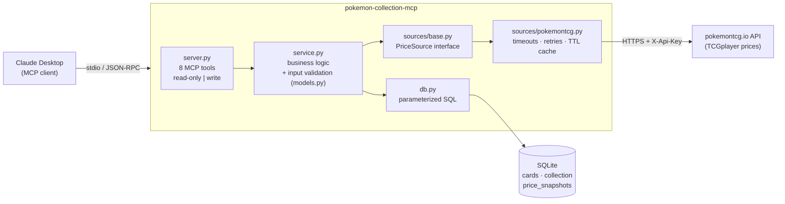

# pokemon-collection-mcp

An [MCP](https://modelcontextprotocol.io) server that lets Claude track your Pokémon TCG collection.
It looks up cards and their TCGplayer market prices (USD, raw cards) through the
[pokemontcg.io](https://pokemontcg.io) API and keeps your collection in a local SQLite database.
It also saves one price per card per day, so over time you build up your own price history.

> **Phase 1 (this release):** search, collection tracking, valuation, price history, movers, set completion.
> **Planned:** grading ROI calculator, booster box EV calculator, photo import, OAuth remote hosting.

## Tools

| Tool | Type | What it does |
|---|---|---|
| `search_card(name, set_name?)` | 🔍 **Read-only** | Find cards and their ids + current market price |
| `collection_value()` | 🔍 **Read-only** | Total value, cost basis, gain/loss |
| `price_history(card_id, days)` | 🔍 **Read-only** | Saved daily prices for a card |
| `top_movers(days, limit?)` | 🔍 **Read-only** | Biggest gainers/losers you own |
| `set_progress(set_name)` | 🔍 **Read-only** | Owned vs total, and the list of missing cards |
| `add_card(card_id, condition, quantity, purchase_price?)` | ✏️ **Write** | Add copies to your collection |
| `remove_card(card_id, quantity, condition?)` | ✏️ **Write** (destructive) | Remove copies (oldest purchase first) |
| `snapshot_prices()` | ✏️ **Write** | Save today's price for every card you own |

Read-only tools never change the database. Each tool is marked in three places:

- a section banner in `server.py`;
- a `[READ-ONLY]` / `[WRITE]` prefix on the tool description;
- MCP `ToolAnnotations` (`readOnlyHint`, `destructiveHint`), which MCP clients can use to decide when to ask for confirmation.

Conditions: `NM`, `LP`, `MP`, `HP`, `DMG`. Purchase price is **per copy**.

## Demo prompts

- *"Find Charizard from Base Set and add 2 near-mint copies, I paid $280 each."*
- *"What's my collection worth? Am I up or down?"*
- *"Snapshot today's prices."* (run daily to build history)
- *"Show me the price history of base1-4 over the last 90 days."*
- *"What were my biggest movers this week?"*
- *"How close am I to completing Scarlet & Violet 151? What am I missing, cheapest first?"*
- *"I sold one LP Blastoise — remove it."*

## Setup

Requires Python 3.12+.

```bash
git clone https://github.com/BertoSolis98/pokemon-collection-mcp.git
cd pokemon-collection-mcp
python3.12 -m venv .venv
source .venv/bin/activate          # Windows: .venv\Scripts\activate
pip install -e ".[dev]"
cp .env.example .env               # then put your key from https://dev.pokemontcg.io in .env
pytest                             # optional: run the tests
```

### Claude Desktop

Edit `claude_desktop_config.json`:

- macOS: `~/Library/Application Support/Claude/claude_desktop_config.json`
- Windows: `%APPDATA%\Claude\claude_desktop_config.json`

```json
{
  "mcpServers": {
    "pokemon-collection": {
      "command": "/absolute/path/to/pokemon-collection-mcp/.venv/bin/pokemon-collection-mcp",
      "env": {
        "POKEMONTCG_API_KEY": "your-key-here"
      }
    }
  }
}
```

On Windows, the command is `...\\.venv\\Scripts\\pokemon-collection-mcp.exe`. Restart Claude Desktop afterwards. The tools then appear under the 🔨 icon.

There are two ways to supply the API key. One is the `env` block above, which lives in your local Claude config. The other is to run the server with its working directory set to the repo, where it reads `.env`. Either way, the key never goes in the repository.

Optional: set `POKEMON_MCP_DB_PATH` to choose where the database lives. The default is `~/.pokemon-mcp/collection.db`.

## Architecture



| File | Responsibility |
|---|---|
| `server.py` | MCP protocol layer. Registers the tools and converts errors into safe messages. |
| `service.py` | What each tool does: valuation, movers, set progress. Validates inputs first. |
| `models.py` | Data classes and allow-list validators for every tool argument. |
| `db.py` | SQLite schema and queries. All queries are parameterized. |
| `config.py` | Loads settings and secrets from the environment and `.env`. |
| `sources/base.py` | The `PriceSource` interface. To add TCGdex, implement this one class. |
| `sources/pokemontcg.py` | pokemontcg.io client: timeouts, 429/5xx retry with backoff, caching. |
| `sources/cache.py` | Small bounded in-memory TTL cache. |

### Data model

- **cards**: `id`, `name`, `set_id`, `set_name`, `number`, `rarity`, `image_url`. This is metadata cached from the API.
- **collection**: one row per purchase *lot*: `card_id`, `condition`, `quantity`, `purchase_price` (per copy), `date_added`. Each lot keeps its own price and date, so the cost basis is exact. `remove_card` takes from the oldest lots first (FIFO).
- **price_snapshots**: `card_id`, `price`, `source`, `captured_date`, with primary key `(card_id, captured_date)`. That key enforces **one snapshot per card per day**; re-running a snapshot on the same day updates that day's price.

**Valuation:**

- `collection_value` uses the latest saved snapshot for each card. If a card has none, it asks the API without saving anything, because the tool is read-only.
- Gain/loss only counts copies with a known purchase price.
- Copies added without a purchase price are reported separately.

## Security design

This project is meant as a security portfolio piece. The main controls:

**Secrets**
- No secrets in code. The API key comes from the environment or from `.env`, loaded with `python-dotenv`.
- `.env.example` documents the variable names without any values.
- `.gitignore` excludes `.env`, `.env.*` and every database file (`*.db`, `*.sqlite`, WAL/journal files).
- `Settings.api_key` is declared with `repr=False`, so printing or logging the settings object doesn't reveal it.
- API error messages never echo the key or the response body. A 401 or 403 just says "check your key", and a test checks this.

**Input validation (allow-list)**
- Every tool argument is validated in `models.py` before it reaches the database or the network:
  - **Card ids** must match `^[A-Za-z0-9][A-Za-z0-9.-]{0,39}$`. This also prevents path traversal into the API URL.
  - **Names** are NFKC-normalized, length-capped and limited to letters, digits and real card-name punctuation. Quotes, backslashes, `*` and brackets are rejected, which **prevents query injection into the pokemontcg.io search syntax**.
  - **Condition** must be one of five known values.
  - **Numeric bounds:** quantity 1–10,000; price 0–1,000,000 and finite (no NaN/∞); days 1–3,650. Booleans are rejected where an integer is expected.
- Pydantic type checks at the MCP layer, plus `max_length` limits on the JSON schema, form a second layer.

**SQL**
- **Parameterized queries only** (`?` placeholders). User input is never string-formatted into SQL.
- The database enforces its own constraints: `CHECK` limits on condition, quantity and price, foreign keys (`PRAGMA foreign_keys = ON`), and the one-snapshot-per-day primary key.
- Multi-step writes such as FIFO removal run in a single transaction: either all of it happens or none of it.
- The database directory is created as `0700` and the file as `0600`, because it holds personal data.

**Least privilege for tools**
- Read-only and write tools are separated and labelled (see the table above). `remove_card` is flagged `destructiveHint=True`, so clients can ask before running it.
- No tool can run arbitrary SQL, touch arbitrary files or call arbitrary URLs. The only outbound host is `api.pokemontcg.io`.

**Error handling and resilience**
- Expected errors (bad input, card not found, API down) are returned as short messages.
- Unexpected exceptions are logged to **stderr** only; stdout is reserved for the MCP protocol. The client sees a generic "Internal error" with no stack trace, paths or internals.
- Every HTTP request has a timeout.
- 429 and 5xx responses are retried with exponential backoff. `Retry-After` is honoured but capped at 30 seconds, so a hostile header can't stall the server.
- Responses are cached in a bounded LRU/TTL cache, which limits memory use and request volume.
- `snapshot_prices` isolates per-card failures, so one bad card doesn't abort the run.

**Supply chain and CI**
- Dependencies are version-bounded in `pyproject.toml`. The MCP SDK is pinned to `<2` because 2.x renamed FastMCP.
- The GitHub Actions workflow runs with `permissions: contents: read` and `persist-credentials: false`, and **needs no secrets**, because the API is mocked in tests.

**Tests**
- The tests make no real network calls. The HTTP layer uses `httpx.MockTransport`, and the tools use an in-memory fake `PriceSource`.
- Security behaviour is tested directly:
  - SQL-injection strings are stored as inert data;
  - query-syntax characters are rejected before any API call;
  - the key never appears in error messages;
  - internal errors are hidden from the client;
  - the database file permissions are owner-only.

**Known limitations, for later phases:** local stdio only, so there is no authentication layer yet (OAuth is planned for remote hosting). Data at rest is not encrypted; it relies on file permissions.

## Development

```bash
pytest -v
```

## Swapping the price source

Implement `PriceSource` in a new file, for example `sources/tcgdex.py`, with `search_cards`, `get_card` and `get_set`. Then construct it in `server.main()`. None of the tools change.
